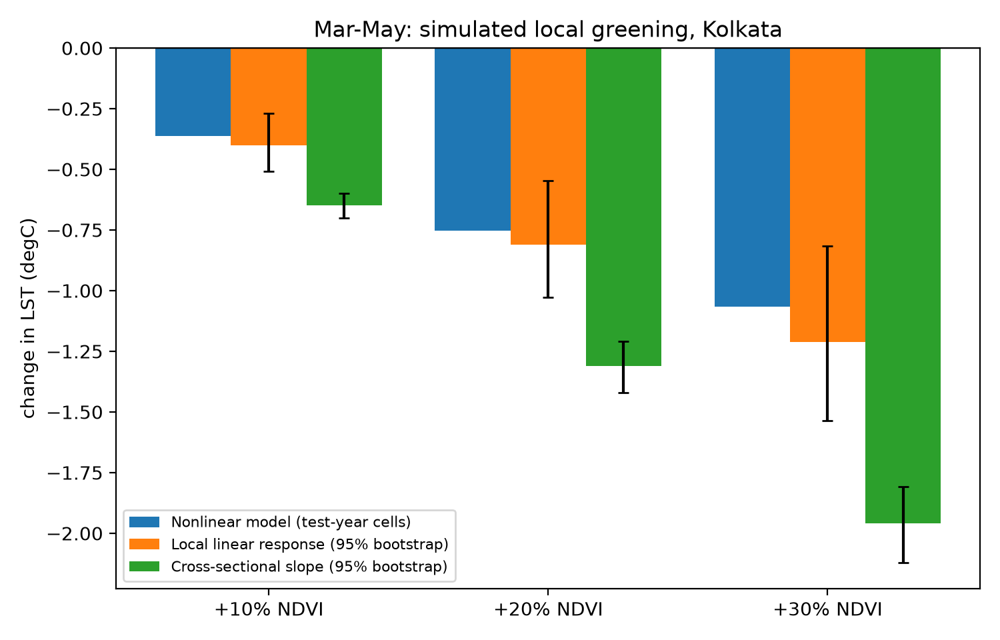

# Vegetation-Heat Response in Kolkata (UHI Forecasting project)

Author: Tamojeet (@iTamojeet)

Landsat 8/9 land surface temperature (LST) and NDVI for the Kolkata core, 2014-2025, at 120 m. The project started as LSTM forecasting of LST and was reframed after the data showed what could and could not be learned. The result is an honest analysis of how strongly LST responds to local vegetation changes and how much the usual cross-sectional slope overstates it.



## Findings

1. **No forecasting skill beyond climatology.** Predicting month t from data through t-1, a linear model on last-observed anomalies (test RMSE 2.11 degC) does not beat per-cell climatology (2.09). Coefficients on past anomalies are near zero. Adding concurrent ERA5 anomalies reaches 1.87, but that uses weather not known in advance, so it is a response model, not a forecast. Flexible models (gradient boosting, and by extension an LSTM) overfit month-level weather because there are only about 55 independent training months.
2. **Month-level error dominates.** Test RMSE splits into a month-level part (1.4-1.7 degC) and a within-month spatial part (about 1.2). Monthly composites rest on 1-6 clear overpasses and are noisy.
3. **NDVI adds small but consistent spatial skill.** A nonlinear spatial model reduces within-month spatial RMSE by about 7% on validation (1.102 to 1.026) and 1.4% on test (1.190 to 1.173). Most NDVI structure is already in the cell climatology.
4. **Cross-sectional NDVI-LST slopes overstate local cooling.** Month-cluster bootstrap, degC per +0.1 NDVI:

| Season | Local response | Cross-sectional | Ratio |
|---|---|---|---|
| All months (58) | -0.35 [-0.54, -0.16] | -1.08 [-1.18, -0.99] | 0.33 [0.16, 0.47] |
| Jan-Feb (15) | -0.24 [-0.38, -0.10] | -0.77 [-0.85, -0.69] | 0.32 [0.14, 0.47] |
| Mar-May (20) | -0.89 [-1.13, -0.60] | -1.44 [-1.56, -1.33] | 0.62 [0.44, 0.75] |
| Oct-Dec (22) | +0.08 [-0.12, +0.29] | -0.94 [-1.03, -0.85] | -0.08 [-0.31, 0.13] |

   The local response is strong in the hot pre-monsoon season and not detectable after the monsoon. The nonlinear model, evaluated independently on test-year cells, agrees by season: -0.80 (Mar-May), -0.25 (Jan-Feb), -0.08 (Oct-Dec) degC per +0.1 NDVI.

5. **Mar-May scenarios** (local greening, city-wide mean fixed; nonlinear model): NDVI +10/20/30% of each cell's value (mean +0.045/+0.091/+0.136) gives about -0.36/-0.75/-1.07 degC, against -0.63/-1.26/-1.89 degC implied by the cross-sectional slope (the figure uses the bootstrap slope instead, giving -0.65/-1.31/-1.96; the nonlinear bars carry no interval). See `docs/figures/marmay_scenarios.png`.

6. **No detectable water cooling reach (inconclusive).** Vegetation-adjusted LST in the first 120 m next to water is 1.6 degC (Hooghly) to 2.5 degC (other water) cooler in Mar-May, but cells 120-400 m from the river are slightly warmer, not cooler, and the profile is shaped by urban structure further out. Masking 30 m water pixels before aggregation cut the first-bin effect only from -1.97 to -1.61 degC (river). Landsat's thermal sensor has a native 100 m footprint, so shoreline cells are likely contaminated by water; I could not separate that from real cooling. Conclusion: no cooling reach beyond the sensor's own footprint can be shown at this resolution (`06_cool_island`).

## Limitations

- No usable July-September observations; 88 of 144 months usable. The model says nothing about the monsoon.
- Test set is about 15 months, roughly one per calendar month; per-month numbers are noisy.
- Scenario outputs are model sensitivity, not causal estimates and are not validated against ground truth. NDVI noise biases local estimates towards zero; confounding inflates cross-sectional ones, so the truth lies between.
- Seasonal differences rest on 15-22 months per season and are exploratory; no mechanism was tested.
- Overpass-time LST (about 10:30 local) is not the daily mean; ERA5 anomalies are area means.

## Method

| Folder | Purpose |
|---|---|
| `01_data_acquisition` | Earth Engine: monthly Landsat 8/9 LST and NDVI composites, ERA5-Land table, JRC water occurrence, coverage log |
| `02_preprocessing` | Usable-month filter (>= 80% valid pixels, <= 5% cold outliers), 120 m cube, land and water mask, spatial blocks, per-image NDVI-LST slopes |
| `03_baselines` | Persistence, climatology, linear, linear + concurrent ERA5. Train <= 2022, val 2023, test 2024-25, plus held-out spatial blocks |
| `04_models` | Gradient boosting and the two-level hierarchical model with an exact month/spatial error decomposition |
| `05_counterfactual` | Local NDVI scenarios, month-cluster bootstrap, final figure |
| `06_cool_island` | Distance-decay of vegetation-adjusted LST from the Hooghly and other water bodies (inconclusive, see finding 6) |
| `07_interactive` | Exports the data for `docs/map/index.html`, an interactive greening map |

Details and revised hypotheses: `docs/DESIGN.md`. Terms: `docs/GLOSSARY.md`.

## Reproduce

```
pip install -r requirements.txt
earthengine authenticate
cd 01_data_acquisition
python acquire_landsat_monthly.py --ee-project YOUR_PROJECT --coverage-only
python plot_coverage.py
python acquire_landsat_monthly.py --ee-project YOUR_PROJECT
python acquire_era5_monthly.py --ee-project YOUR_PROJECT
python acquire_water_mask.py --ee-project YOUR_PROJECT
cd ..
python 02_preprocessing/verify_stage1.py
python 02_preprocessing/build_cube.py
python 03_baselines/baselines.py
python 04_models/gbm.py
python 04_models/hierarchical.py
python 05_counterfactual/ndvi_scenarios.py
python 05_counterfactual/bootstrap_ci.py
python 05_counterfactual/make_final_figure.py
python 06_cool_island/cool_island.py
python 07_interactive/export_web_data.py
```

After stage 01, `bash run_pipeline.sh` runs stages 02-06 and logs the output.

## Figures

`docs/figures/`: `coverage_heatmap.png`, `stage2_overview.png`, `baselines.png`, `ndvi_scenarios.png`, `marmay_scenarios.png`.